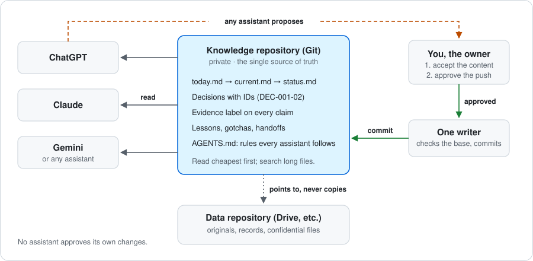

# AI Continuity Kit

**Keep your projects resumable across ChatGPT, Claude, Gemini — or any assistant
— without trusting any of them to remember.**

[](LICENSE)
[](CHANGELOG.md)
[](https://github.com/Frotart/ai-continuity-kit/generate)

**Start in two minutes:** click **Use this template** → create a **private**
repository → give your assistant read access and say *"Read AGENTS.md and
today.md, then tell me where PRJ-001 stands."* PRJ-001 is a synthetic example;
replace it with your first real project.

AI assistants forget, half-remember, or remember the wrong version. Switch
providers, open a new chat, or come back after a month, and you're re-explaining
everything. Worse, an assistant may confidently "remember" a decision you never
made.

This kit is a ready-to-copy structure for a **private Git repository that acts
as the single source of truth for your project knowledge**. Every assistant
reads from it, every claim in it is labelled by how well it's verified, and
only approved changes get written back.



## Who it's for

- You run several projects (a business, studies, a side project) and use
  more than one AI assistant, or expect to switch.
- You've been burned by an assistant "remembering" something that was never
  decided.
- You want a record you own, in plain Markdown, that any assistant can read
  and nobody can quietly rewrite.

You don't need to code. You need a GitHub account and a habit of ending each
session with a short review.

## Core ideas

1. **Two repositories, two jobs.** Git holds *knowledge*: purpose, decisions,
   status, lessons. Your cloud drive (or other system) holds *data*: original
   documents, records and anything confidential. Knowledge points to data; it
   never copies it.
2. **Evidence labels on every material claim.** `VERIFIED`, `OWNER DECISION`,
   `DOCUMENT CLAIM`, `PROPOSED`, `UNVERIFIED`, `HISTORICAL`. An assistant can
   then tell "we decided this" from "someone suggested this" from "this was true
   in March".
3. **Assistants propose; the owner approves; one writer commits.** No assistant
   approves its own changes, and parallel assistants never race to overwrite
   each other.
4. **Short files are read first; long files are searched.** Each project has
   an `overview.md` (what and why), a short `current.md` (where it stands now,
   read at the start of every session) and a `status.md` (the full dated
   history). A root `today.md` answers "what should we do now?" across all
   projects in one read.
5. **Every session ends with a reviewed update.** The assistant drafts the
   changes to `current.md` and `today.md`; you approve the content and,
   separately, the push. Nothing important stays only in a chat.
6. **Entries are typed and findable.** Decisions get IDs (`DEC-001-02`) so
   later records cite instead of retelling; lessons and gotchas get specific,
   searchable first lines; procedure steps that aren't safe to repeat are
   marked.
7. **Handoffs are explicit.** When work moves between assistants, the handoff
   states the Git revision, what's verified, what's only proposed, and the next
   safe action.

## How it compares

| | Built-in assistant memory | Automatic memory plugins | A notes app or wiki | **This kit** |
| --- | --- | --- | --- | --- |
| Works across providers | No, one provider | Often one tool | Yes, if you paste it in | **Yes, any assistant that reads Git** |
| You approve what's kept | Partly | No, captured automatically | Yes | **Yes, every change** |
| Tells a decision from a suggestion | No | No | Only if you write it | **Yes, evidence labels** |
| Rules for how assistants read and write | No | Built into the tool | No | **Yes, `AGENTS.md`** |
| Setup and upkeep | None | Install and run a service | Low | **Copy a template; a review per session** |

Use built-in memory for casual chats. Use this kit for projects where a wrong
"fact" costs you time or money.

## I want to…

| I want to… | Read |
| --- | --- |
| Know what to do now | [today.md](today.md) |
| Resume a project | Its `current.md`, via [projects/index.md](projects/index.md) |
| See a worked example | [PRJ-001, synthetic](projects/PRJ-001/current.md) |
| Understand the labels | [Why evidence labels](docs/why-evidence-labels.md) |
| Learn the rules assistants follow | [AGENTS.md](AGENTS.md) |
| End a session properly | [prompts/end-of-session.md](prompts/end-of-session.md) |
| Test an assistant can resume | [prompts/continuity-test.md](prompts/continuity-test.md) |
| Decide what may go in the repo | [policies/classification.md](policies/classification.md) |
| Hand work to another assistant | [templates/handoff.md](templates/handoff.md) |

## Layout

```
README.md                  ← you are here (entry point for humans and AIs)
AGENTS.md                  ← working instructions every assistant follows
today.md                   ← running priority list across all projects
CHANGELOG.md               ← what changed in the kit, and why
CONTRIBUTING.md            ← how to suggest improvements
docs/
  why-evidence-labels.md   ← the idea behind the labels
policies/
  classification.md        ← what may and may not enter the repository
  approval.md              ← how a proposal becomes an accepted record
projects/
  index.md                 ← directory of all project IDs, incl. closed/merged
  PRJ-001/                 ← a fully worked SYNTHETIC example project
    overview.md            ← what and why
    current.md             ← where it stands now (read first)
    status.md              ← full dated history and milestones
templates/                 ← blank files to copy
  overview.md · current.md · status.md · knowledge.md
  milestone.md · handoff.md
  reference.md             ← shared facts several projects rely on
  assistant-file.md        ← optional CLAUDE.md / GEMINI.md layer
handoffs/
  sample.md                ← synthetic example handoff
prompts/
  continuity-test.md       ← check an assistant can resume from the repo
  end-of-session.md        ← turn a session into one reviewed update
```

## Getting started

1. **Use this template** (or copy the files) into a new **private** repository.
2. Edit `README.md`'s "Where information belongs" table for your own data
   locations.
3. Delete the synthetic `projects/PRJ-001/` example once you've read it, or keep
   it for reference.
4. For each real project, copy `templates/overview.md`, `templates/current.md`
   and `templates/status.md` into `projects/PRJ-NNN/` and add a row to
   `projects/index.md`. Add `knowledge.md` once the project produces lessons
   worth keeping.
5. Point each assistant at the repository. With connectors (GitHub for Claude,
   ChatGPT or Gemini), give it read access; otherwise paste the files it needs.
   Start each work session with: *"Read AGENTS.md and today.md from the
   knowledge repository, then current.md for PRJ-NNN."* If your assistant
   supports its own instruction file, copy `templates/assistant-file.md` to
   the root as `CLAUDE.md`, `GEMINI.md` or similar.
6. End each session with `prompts/end-of-session.md`.
7. Run `prompts/continuity-test.md` with each assistant. If one can't
   reconstruct a project's state from the repository alone, improve the records,
   not the prompt.
8. When the same facts keep appearing in several projects, move them into a
   root `reference.md` (see `templates/reference.md`).

## Where information belongs

| Information | Home |
| --- | --- |
| Project purpose, decisions, status, reusable lessons | `projects/PRJ-NNN/` in this repository |
| Original documents, datasets, records, evidence | Your data repository (e.g. Google Drive), in the owning project's folder |
| Credentials, recovery codes, secrets | A password manager — **never** here |
| Current working copies | The local workspace for the task |

## What this is not

- **Not access control.** The instructions shape assistant behaviour; actual
  protection comes from repository privacy, connector permissions and your
  accounts.
- **Not a backup.** Git history helps, but keep separate backups of anything
  you can't lose.
- **Not a place for sensitive data.** A private repository is still hosted by a
  third party. See `policies/classification.md`.

## Why it works this way

The kit is extracted from a real knowledge repository that runs business,
study and personal projects with several AI assistants in parallel. Each rule
answers a specific failure:

- **Evidence labels**, because a suggestion repeated across chats starts to
  look like a decision.
- **Separate approval for content and for pushing**, because "looks good" is
  easy to over-read as permission to publish.
- **`current.md` and `today.md`**, because reading long status files at the
  start of every session costs more than it's worth.
- **A data repository that Git only points to**, because a private repository
  is still a third party's server.

- **Decision IDs and typed entries**, because a decision retold in five
  places drifts into five slightly different decisions.
- **An off-record rule**, because not every chat is project work, and a
  curious question shouldn't become a recorded commitment.

[CHANGELOG.md](CHANGELOG.md) records each change and the lesson behind it.
[Why evidence labels](docs/why-evidence-labels.md) explains the core idea in
more depth.

## FAQ

**Does this need a paid AI plan?** No. Any assistant that can read a GitHub
repository, or files you paste in, can follow it. Connectors make it smoother.

**Can I use it with just one assistant?** Yes. You still get a record you own,
labelled claims and clean session endings; switching later costs nothing.

**Is a private GitHub repository safe for my data?** It's still a third party's
server, so the kit keeps confidential originals in your data repository and
only points to them. See [policies/classification.md](policies/classification.md).

**Isn't the review at the end of each session slow?** It's one prompt and one
read of a short diff. It replaces re-explaining your project at the start of
the next session.

## Feedback and ideas

This is a living system, and I'd like to hear how others solve the same
problem. [Open an issue](https://github.com/Frotart/ai-continuity-kit/issues/new/choose)
if something is unclear, if you've adapted the kit for a different workflow,
or if one of the rules doesn't hold up in your use. Small frictions count.
See [CONTRIBUTING.md](CONTRIBUTING.md). If the kit helps you, a star helps
others find it.

Built by [Rashad Rameez](https://github.com/Frotart)

## License

MIT — see [LICENSE](LICENSE). Use it, adapt it, and share improvements.
